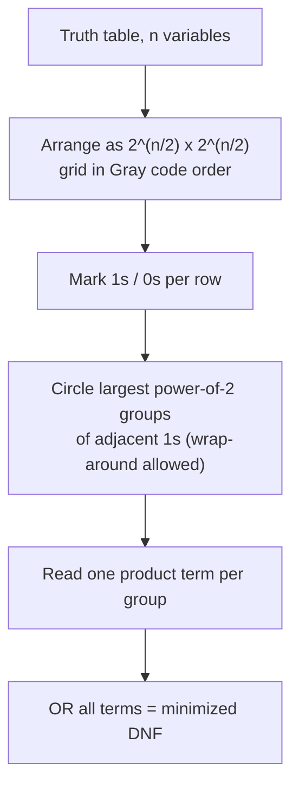

## Summary

A Karnaugh map (KV-Diagramm, "Karnaugh-Veitch diagram") is a grid-based tool
for minimizing Boolean functions by exploiting adjacency: cells that differ
in exactly one variable are placed next to each other, so groups of
adjacent 1s (sized in powers of two: 1, 2, 4, 8, ...) can be read off
directly as simplified product terms.

## How it works

1. Lay out all input combinations as rows/columns using **Gray code**
   ordering (so adjacent cells differ by one bit), split across two
   variable groups (e.g. rows = `X₃X₄`, columns = `X₁X₂`).
2. Fill in the function's output (0/1) for every cell from the truth table.
3. Circle rectangular groups of adjacent 1s that are as large as possible
   (powers of two: 1, 2, 4, 8 cells), allowing wrap-around at the map edges.
4. Each group becomes one product term: variables that stay constant across
   the group appear in the term (complemented if 0, uncommented if 1);
   variables that change are dropped.
5. OR all the group terms together for the minimized DNF (dually, group 0s
   for a minimized CNF).

The source notes worked examples up to 4 variables (e.g. a 4x4 map with
`X̄₄,X₃,X₂,X̄₁` headers), producing minimized DNFs like
`X̄₁*X̄₃ + X₁*X̄₂*X̄₄ + X̄₁*X̄₂*X̄₄ + X̄₁*X₂*X̄₃` from a larger canonical form, and
reducing a 4-variable design down to a single term such as `Z = X̄₃`.

## Related pages

- [[topics/boolean-algebra]]
- [[topics/switching-functions-and-gates]]
