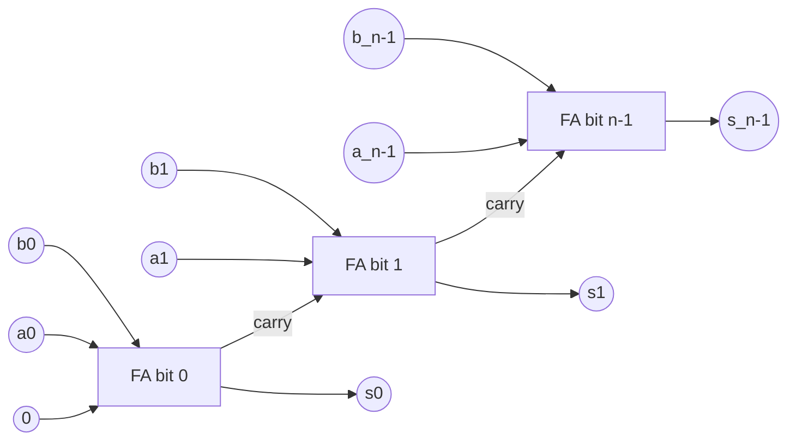
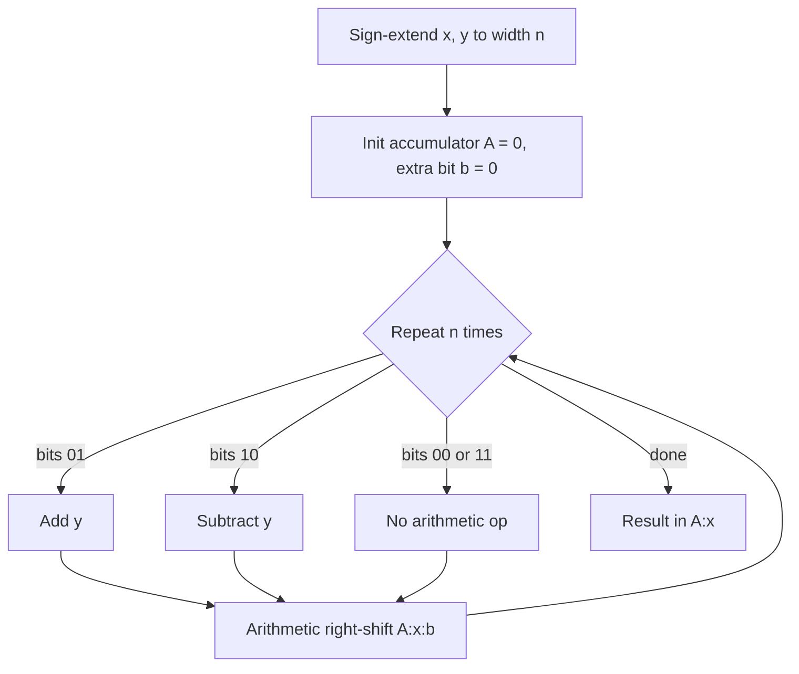

## Summary

Covers how computers represent signed integers in binary and perform the
four basic arithmetic operations on them: addition/subtraction via adder
circuits, multiplication (school method and Booth's algorithm for signed
operands), and division (restoring division).

## Signed number representations

- **Vorzeichen (sign) bit**: the highest-order bit; `0` = positive, `1` =
  negative.
- **Ones' complement (Einerkomplement)**: negate a number by inverting
  every bit. To check: `0₁₀ = 0000₂ = 1111₂` (both encode zero — this
  representation has two zeros, a known drawback).
- **Two's complement (Zweierkomplement)**: negate a number by inverting
  every bit and adding 1. This is the representation used in the worked
  exercises, e.g. `9 = 01001 → -9 = 10110 + 1 = 10111`.
- **Decoding value**: for an n-bit two's-complement number
  `(z_{n-1},...,z_1,z_0)`, if the highest-order bit is `0` the value is
  `Σ zᵢ·2ⁱ`; if it is `1` the value is `-2ⁿ⁻¹ + Σ zᵢ·2ⁱ` (equivalently
  `-2ⁿ + Σ zᵢ·2ⁱ` for the full n-bit sum), i.e. the top bit carries a
  negative weight.
- **Overflow**: when adding two two's-complement numbers, an overflow has
  occurred whenever the carry **into** the sign bit differs from the carry
  **out of** the sign bit; practically, "for every surplus `1` [beyond the
  bit width] an invalid carry results."

## Half adder and full adder

**Half adder (Halbaddierer)**: adds two bits, no carry-in.

| a | b | s (sum) | c (carry) |
|---|---|---------|-----------|
| 0 | 0 | 0 | 0 |
| 0 | 1 | 1 | 0 |
| 1 | 0 | 1 | 0 |
| 1 | 1 | 0 | 1 |

`c = a·b`, `s = a⊕b`.

**Full adder (Volladdierer)**: adds two bits plus a carry-in `Cᵢ`.

| a | b | Cᵢ | s | Cₒᵤₜ |
|---|---|----|----|------|
| 0 | 0 | 0 | 0 | 0 |
| 0 | 0 | 1 | 1 | 0 |
| 0 | 1 | 0 | 1 | 0 |
| 0 | 1 | 1 | 0 | 1 |
| 1 | 0 | 0 | 1 | 0 |
| 1 | 0 | 1 | 0 | 1 |
| 1 | 1 | 0 | 0 | 1 |
| 1 | 1 | 1 | 1 | 1 |

**N-bit adder**: a ripple-carry chain of full adders, each stage's carry-out
feeding the next stage's carry-in, starting from `Cᵢₙ = 0` on the
least-significant bit.



## Binary multiplication: school method (unsigned)

The straightforward shift-and-add long multiplication, same as decimal
long multiplication: multiply the multiplicand by each bit of the
multiplier (shifted into position), then sum all partial products.
Worked exercise: `1010·1101 = 10000010 = 130₁₀`.

## Booth's algorithm (signed multiplication)

Booth's algorithm multiplies two's-complement numbers `x` (multiplier) and
`y` (multiplicand) directly, without separately handling signs. Both
operands must be sign-extended to the same bit width `n` before starting.

**Pseudocode (from source):**
```
find x2 and y2 with length(y2) = length(x2)
y2 * x1
A = 0...0 (accumulator, same width as y2), initialize with 0 in an extra bit
for i := 1 to n do
    if (x_0 b) == 10:              // bit pair transition 1 -> 0
        Sub y  (i.e. Add -y)
    if (x_0 b) == 01:              // bit pair transition 0 -> 1
        Add y
    shift (y:x) right by 1 bit, arithmetic shift (sign-extending)
endfor
y:x = y*x
```

Each step inspects the current bit and the bit just shifted out (the
"recoding" bit `b`): `11` and `00` mean "no operation, just shift"; `01`
means "add the multiplicand"; `10` means "subtract the multiplicand" —
annotated in the source as:

| bit pair | action |
|----------|--------|
| 11 | shift only |
| 00 | shift only |
| 01 | Add y |
| 10 | Subtract y |

Worked exercises: `17·9 = 153`, `(-11)·(-20) = 220`, `23·(-31) = -713`,
`(-32)·(-9)` via Booth's algorithm, confirmed against the decimal products.



## Restoring division

Divides unsigned `X` by `D` (`X/D`), producing quotient `Q` and remainder
`R`, using a width `n = length(X)`.

**Pseudocode (from source):**
```
for i := 1 to n do
    left-shift A:Q by 1 bit
    A = A - D
    if A < 0:
        restore: A = A + D; append 0 to Q
    else:
        append 1 to Q
endfor
A = remainder
Q = X / D
```

This is called "restoring" because whenever a trial subtraction makes the
partial remainder `A` negative, the divisor is added back (restored)
before continuing. Worked exercises divide `81/18` (= 4 remainder 9) and
`91/13`, `59/4`, `39/16` step by step, tracing the `A`/`Q` register pair
each iteration.

## Related pages

- [[topics/flip-flops-and-sequential-logic]]
- [[topics/computer-architecture-and-isa]]

## Open questions / gaps

- Booth's algorithm derivation itself (why the `01`/`10` recoding works) is
  not justified in the source, only the operational steps and worked
  examples — flagged in case a deeper proof is wanted later.
