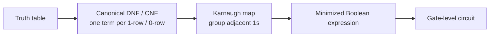

## Summary

Boolean algebra is the algebra of logic values (0/1, false/true) with the
operations AND (`*`), OR (`+`), and NOT (overline/complement). It provides
the laws used to simplify logical expressions and switching functions
(Schaltfunktionen), and underlies the canonical forms (DNF/CNF) used to
derive circuits from truth tables.

## Laws of Boolean algebra

| # | Law | AND / OR form |
|---|-----|----------------|
| 1 | Commutativity | `A+B = B+A`, `A*B = B*A` |
| 2 | Identity element | `0+A = A`, `1*A = A` |
| 3 | Distributivity | `(A+B)*C = (A*C)+(B*C)`, `(A*B)+C = (A+C)*(B+C)` |
| 4 | Complement | `A+Ā = 1`, `A*Ā = 0` |
| 5 | Associativity | `A+(B+C) = (A+B)+C`, `A*(B*C) = (A*B)*C` |
| 6 | Idempotence | `A+A = A`, `A*A = A` |
| 7 | Absorption | `A+(A*B) = A`, `A*(A+B) = A` |
| 8 | Extremal laws | `A+1 = 1`, `A*0 = 0` |
| 9 | Double complement | `Ā̄ = A` |
| 10 | Complement of constants | `0̄ = 1`, `1̄ = 0` |
| 11 | De Morgan's laws | `(A+B)‾ = Ā*B̄`, `(A*B)‾ = Ā+B̄` |

De Morgan's laws generalize to any number of variables, e.g.
`(A+B+C)‾ = Ā*B̄*C̄`, and are the basis for converting between AND/OR and
NAND/NOR-only circuits (see [[concepts/functional-completeness]]).

## Minterms, maxterms, and canonical forms

- **Minterm**: a product (AND) term in which every variable of the function
  appears exactly once (complemented or not). Example: `X̄₁*X₂*X̄₃*X₄`.
- **Maxterm**: a sum (OR) term in which every variable appears exactly once.
  Example: `X̄₁+X₂+X̄₃+X₄`.
- **Disjunctive Normal Form (DNF)**: an OR of product terms, e.g.
  `(X)+(X*Ȳ)+(X*Z̄)`.
- **Conjunctive Normal Form (CNF/KNF)**: an AND of sum terms, e.g.
  `(X)*(X+Ȳ)*(Y+Z̄)`.
- **Canonical DNF (KDNF)**: OR of *all* minterms for which the function is 1
  — "addition of minterms".
- **Canonical CNF (KKNF)**: AND of *all* maxterms for which the function is 0
  — "multiplication of maxterms".

Any switching function can be read directly off its truth table as a KDNF
(one minterm per output-1 row) or a KKNF (one maxterm per output-0 row), then
minimized.

## Minimization with Karnaugh maps

Canonical forms are large and redundant; they're minimized with
[[concepts/karnaugh-map]] (KV-Diagramm) or algebraic simplification using the
laws above (especially absorption and De Morgan's). Worked exercises in the
source (Blatt 1/2) minimize 2–5 variable functions this way, reducing a
multi-term KDNF down to 1–3 terms.

## Related pages

- [[concepts/karnaugh-map]]
- [[concepts/functional-completeness]]
- [[topics/switching-functions-and-gates]]

## Open questions / gaps

- None — source pages were legible and self-consistent.
