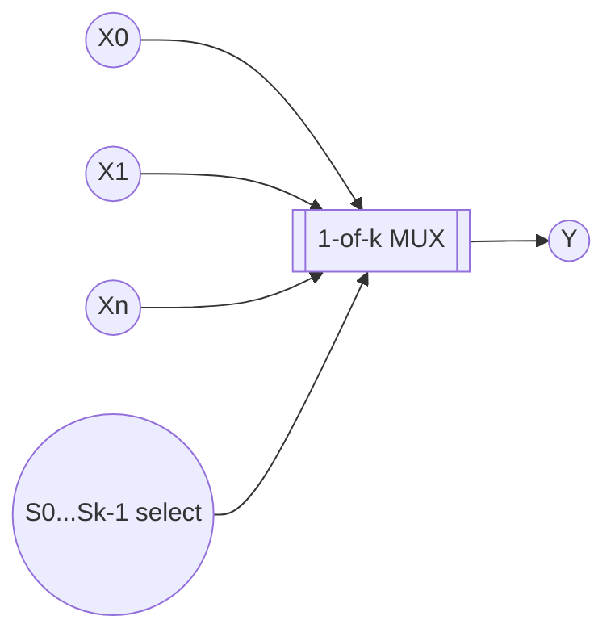
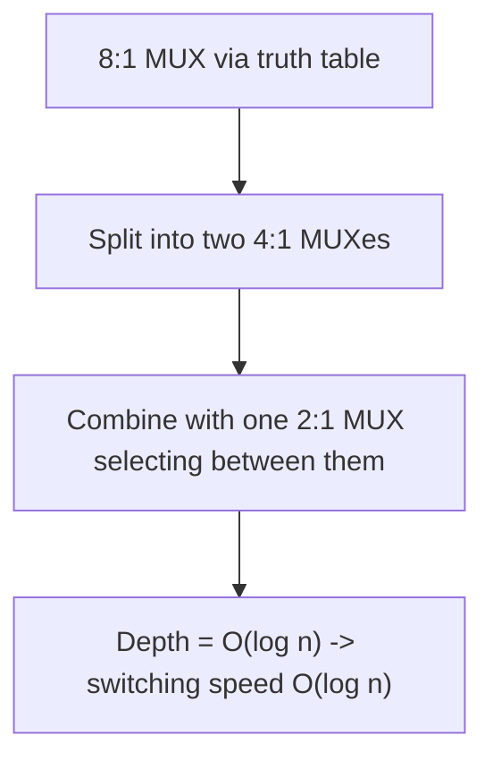
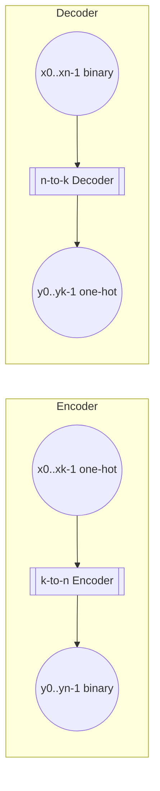

## Summary

Combinational building blocks that route or convert data without storing
state: multiplexers select one of many inputs, demultiplexers route one
input to one of many outputs, encoders compress a one-hot signal into a
binary code, and decoders expand a binary code into a one-hot signal.

## 1-out-of-k Multiplexer (1-aus-k-Multiplexer)

- `n` select/control lines `S₀,...,S(n-1)` (Steuerleitungen, Eingänge)
- `k = 2ⁿ` data inputs `X₀,...,X(k-1)`
- One output `Y`
- Behavior: `Y = Xᵢ` when the select lines encode the value `i` (i.e.
  `(S(n-1),...,S₁,S₀) = i`).

### Multiplexer complexity

- Gate count (area) grows with the number and type of gates, which scale
  with the number of gate inputs (fan-in).
- A larger `n:1` multiplexer can be built recursively from smaller ones
  (e.g. an 8:1 MUX from two 4:1 MUXes plus a 2:1 MUX stage), halving the
  "width" at each recursion level: `#MUX-blocks(n) = n/2` per level.
- **Switching speed** is determined by circuit *depth* (number of gate
  layers a signal must pass through): `v_s(MUX) = O(log n)`.

## 1-to-k Demultiplexer (1-zu-k-Demultiplexer)

- One input `X`, `n` select lines, `k = 2ⁿ` outputs `y₀,...,y(k-1)`.
- Behavior: `yᵢ = X` when the select lines encode `i`; all other outputs
  are inactive/0.

## k-to-n Encoder (k-zu-n-Codierer)

- `k = 2ⁿ` one-hot inputs `x₀,...,x(k-1)` (exactly one input is 1 at a
  time).
- `n` outputs `y₀,...,y(n-1)` encoding, in binary, which input index `i`
  was active: `(y(n-1),...,y₀)₂ = i`.

## n-to-k Decoder (n-zu-k-Decodierer)

- `n` binary-coded inputs, `k = 2ⁿ` outputs.
- Behavior: exactly one output `yᵢ = 1` where `i` is the value encoded by
  the inputs; all others are 0. Decoders are also used to implement ROM
  address decoding (see [[topics/electronic-devices-and-memory]]).

## Related pages

- [[topics/boolean-algebra]]
- [[topics/switching-functions-and-gates]]
- [[topics/flip-flops-and-sequential-logic]]
