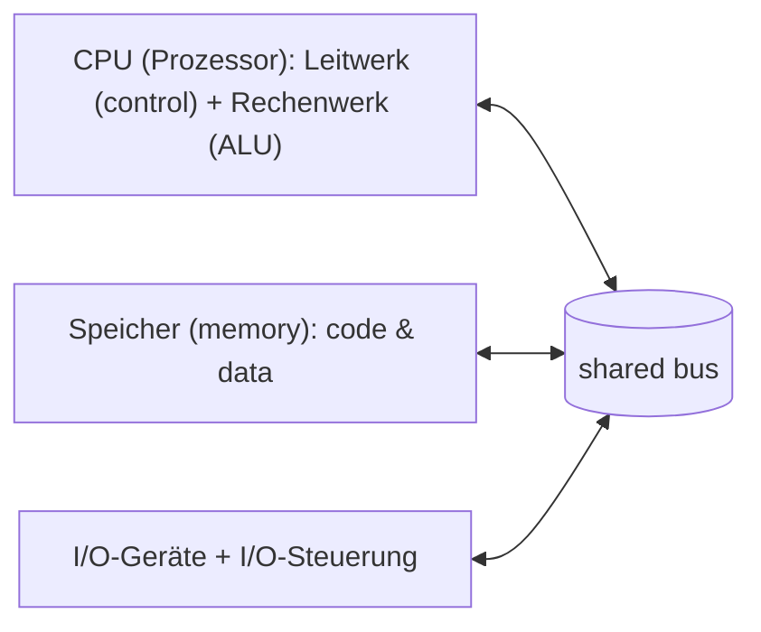
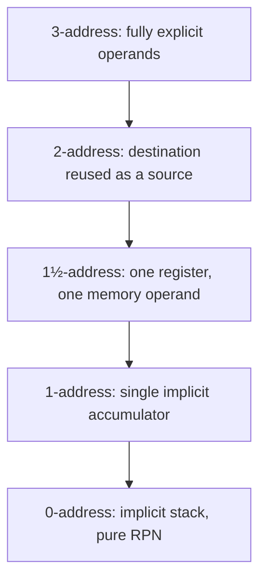

## Summary

Computer architecture (Rechnerarchitektur) is the discipline of designing
computer systems from building blocks (memory, arithmetic units, buses).
This page covers its definitions, the Von Neumann model, how instructions
address their operands, the family of "n-address" instruction-set styles,
Reverse Polish Notation as the natural fit for stack machines, instruction
groups, pipelining throughput, and the CISC vs. RISC design philosophies.

## What is computer architecture?

- **Stone's definition**: "The study of computer architecture is the study
  of the organization and interconnection of components of computer
  systems. Computer architects construct computers from basic building
  blocks such as memories, arithmetic units and buses. From these building
  blocks the computer architect can construct any of a number of different
  types of computers... computer architecture is the discipline devoted to
  the design of highly specific and individual computers from a collection
  of common building blocks."
- **Amdahl/Blaauw/Brooks' definition**: "architecture" describes the
  attributes of a system as seen by the programmer — i.e. the conceptual
  structure and functional behavior — as distinct from the organization
  and data/control flow of the logical and physical implementation.
- **Internal vs. external architecture**: *external* architecture
  describes the programmer-visible interface, i.e. the **instruction set
  architecture (ISA)** (the application program interface to the
  hardware). *Internal* architecture describes the **microarchitecture** —
  how the computer is internally structured and built to realize that ISA.

## Von Neumann model

1. A computer consists of three functional units: **memory (Speicher)**,
   **control + arithmetic unit (Leitwerk/Rechenwerk, together the CPU)**,
   and **I/O devices**.
2. The structure of the machine is independent of the program being
   processed — the machine is **stored-program** (speicherprogrammierbar).
3. Instructions and data (operands) are stored in the **same physical
   memory**.
4. Memory is divided into cells of equal size; cells are addressed by
   number.
5. A program is a sequence of consecutive instructions, processed in
   storage order.
6. Deviations from sequential order are possible via **jump instructions**.
7. Numbers are represented as sequences of binary digits, as are all other
   data.
8. There is no explicit tag for the represented type (the hardware does
   not know whether a memory word is an instruction or data/a number).



## Addressing granularity

Instructions reference operands with different numbers of explicit memory
addresses:

- **0-stage addressing (0-stufige Adressierung)**: operand already in a
  register, e.g. `inc $15`, `clr r3`.
- **1-stage addressing**: a direct or immediate value, e.g. `lw $15, 3`
  (register-immediate), `ld D3, #100` (load immediate).
- **2-stage addressing**: direct/absolute addressing, e.g.
  `lw $15, Adr` (`Reg[15] = Speicher[Adr]`), register-indirect addressing,
  e.g. `lw $15, (R2)` (`Reg[15] = Speicher[Reg[R2]]`).
- **3-stage addressing**: double-indirect addressing, e.g.
  `D[Reg] = Speicher[Speicher[Adr]]`.

## Address machines (n-address instruction sets)

The number of explicit memory/register addresses an ALU instruction
carries defines the "address machine" style:

| Style | Pattern | Example |
|-------|---------|---------|
| 3-address | `Speicher[S1] = Speicher[S2] ∘ Speicher[S3]` | `add r1,a,b` |
| 2-address | `Speicher[S1] = Speicher[S1] ∘ Speicher[S2]` | `move t1,a` / `add t1,b` |
| 1½-address | `Reg[r] = Reg[r] ∘ Speicher[S]` | `lw $1,a` then `add $1,b` |
| 1-address (accumulator) | `accu = accu ∘ Speicher[S]` | `lw a` / `add b` / `mult c` |
| 0-address (stack machine) | implicit stack operands | `push a` / `push b` / `add` |

**Stack machine (0-address) operations:**
- `push a` = push `Speicher[a]` onto the top of the stack.
- `add` = pop the top two stack elements, add them, push the sum.
- `pop a` = `Speicher[a] = top of stack`, then pop it off.

Worked exercise: compiling `(a+b)²·10` for each address-machine style
(3-address, 2-address, 1½-address, 1-address/accumulator, 0-address/stack)
produces progressively shorter instructions but more of them, as fewer
explicit addresses are carried per instruction — the classic
space/explicitness trade-off between address-machine styles.



## Reverse Polish Notation (RPN / UPN)

**UPN (Umgekehrte Polnische Notation)** writes operators *after* their
operands (postfix), e.g. `1/x → 1 x /`. RPN is the natural notation for a
**0-address (stack) machine**: each operand pushes to the stack, each
operator pops its arguments and pushes the result — directly mirroring
`push`/arithmetic-op stack-machine code. Expressions are naturally modeled
as binary expression trees, evaluated/emitted bottom-up (post-order
traversal) to produce the RPN/stack code.

## Instruction groups (Befehlsgruppen)

A typical instruction set partitions into these groups:
- **Transfer instructions** (`lw`, `sw`, `mfhi`) — move data between
  registers/memory.
- **I/O instructions** (`in`, `out`).
- **Arithmetic instructions** (`add`, `sub`, `mul`, `div`).
- **Logic instructions** (`and`, `or`, `not`).
- **Comparison instructions**.
- **Bit/flag instructions**.
- **Shift instructions**.
- **Jump instructions**.
- **Control instructions**.
- **Non-interruptible instructions** (Ununterbrechbare Befehle) — atomic
  instructions that cannot be interleaved by an interrupt, important for
  e.g. synchronization primitives.

## Pipelining throughput

Pipelining ("Fließbandarbeit" — assembly-line work) overlaps the
sub-steps of successive instructions/tasks across stages
(`A → B → C → D`) so each stage works on a different item concurrently
rather than waiting for a full pass to finish before starting the next.

Worked example (4-stage pipeline, 975 items):
- **Without pipelining** (fully sequential, 4 stages per item): total time
  `t = 2·4·975 = 7800` (time units).
- **With pipelining**: total time
  `t = (stage time) + (stages − 1)·(stage interval) = 8 + 2·(975−1) = 1956`.
- Time until the **first** result emerges: `t = 8` (time units).
- With one stage taking 6 units instead of 2 (an uneven pipeline):
  `t = (2+2+2+6) + 6·974 = 5856`.

Pipelining reduces overall *throughput* time dramatically for large batch
sizes, even though a single item's *latency* through all stages is
unchanged or slightly increased by stage imbalance.

## CISC vs. RISC

**CISC (Complex Instruction Set Computer):**
- Advantage: compact programs possible, since the instruction set is very
  rich/powerful.
- More internal cycles are needed per CISC instruction (each instruction
  does more work internally).
- Realized via **microprogramming** (microcode interprets each complex
  instruction as a sequence of simpler internal steps).
- Compilers often don't use the majority of the available instructions.

**RISC (Reduced Instruction Set Computer):**
- Few, simple instructions → **fixed instruction length**.
- High clock/throughput rate, achieved by:
  - a small, uniform number of sub-cycles per instruction, and
  - pipeline processing (see above).
- RISC largely abandons microprogramming in favor of direct hardwired
  control.

**Program runtime formula:**
```
program runtime = (#instructions executed) × (CPI) × (cycle duration)
CPI (cycles per instruction) = average number of sub-cycles per instruction
```
RISC aims to minimize CPI and cycle duration (via pipelining and simple,
uniform instructions); CISC aims to minimize the instruction count (via
powerful, compact instructions), at the cost of higher CPI.

## Related pages

- [[topics/binary-arithmetic-and-adders]]
- [[topics/finite-state-machines]]

## Open questions / gaps

- The worked "n-address machine" table for an n-stage addressing exercise
  (`n` vs. instruction-count `u`) was only partly legible for `n=2`
  (crossed out/illegible value) — flagged in case it needs revisiting
  against the original.
