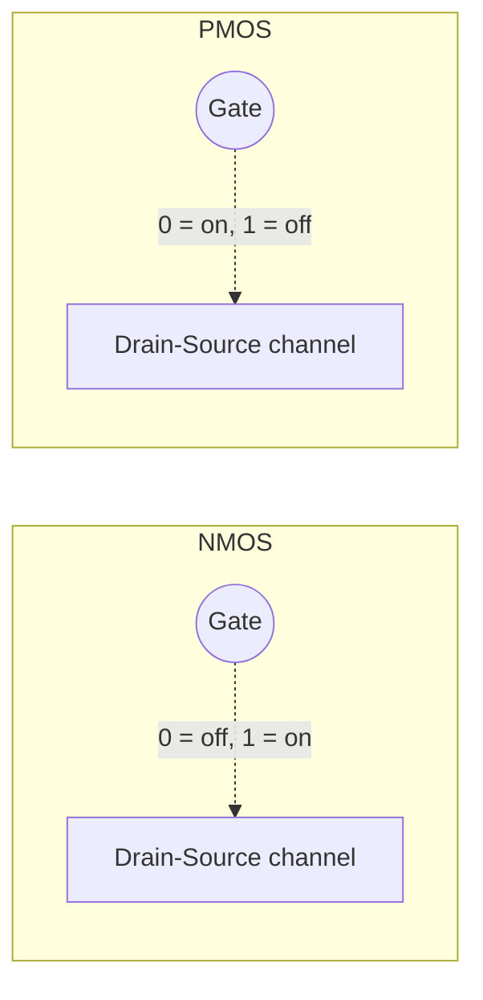
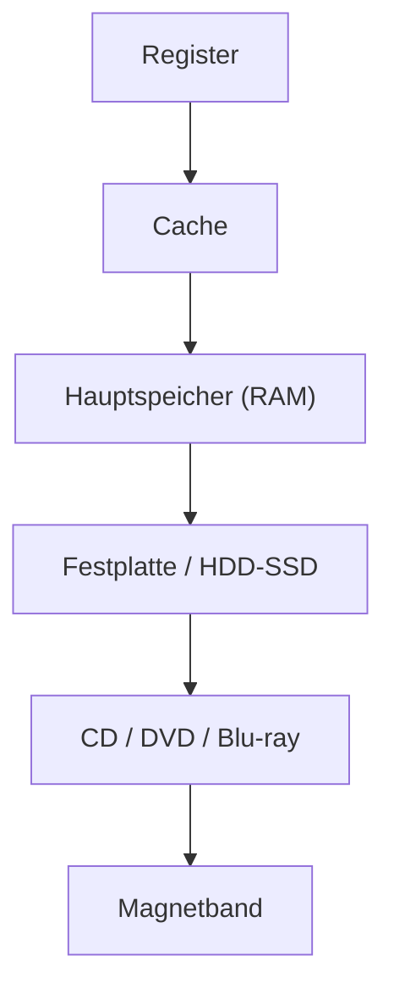

## Summary

Brief overview of the physical building blocks beneath logic gates (diodes,
transistors, MOSFETs) and the basic read-only memory family (ROM/PROM/
EPROM), as covered at the end of ti_1.pdf.

## Diode

Passes current in one direction only; symbol is a triangle pointing to a
bar.

## Transistor (BJT)

- **NPN**: small current into the Base lets current flow Collector→Emitter
  (transistor becomes conductive).
- **PNP**: mirror-image structure/behavior of NPN.

## MOSFET

- **NMOS**: Gate = 0 → transistor blocks (sperrt); Gate = 1 → conducts
  (leitet).
- **PMOS**: Gate = 0 → conducts; Gate = 1 → blocks. (Opposite of NMOS.)

## Read-only memory family

- **ROM (Read-Only Memory)**: values fixed at manufacturing time.
- **PROM (Programmable ROM)**: end-user programmable (once), built from
  decoders and diodes (Decoder & Diode).
- **EPROM (Erasable PROM)**: reprogrammable.

## Combinational vs. sequential circuits (recap)

A sequential circuit (Schaltwerk) may contain feedback (Rückkopplung); a
purely combinational circuit (Schaltnetz) never does. See
[[topics/flip-flops-and-sequential-logic]] for the sequential side.

## Memory hierarchy (Speicherhierarchie)

Storage technologies trade off access speed against capacity/price,
typically drawn as a pyramid from fastest/smallest at the top to
slowest/largest at the bottom:

Access speed and price decrease top-to-bottom; capacity increases
top-to-bottom. Units: `1 KByte = 1024 Byte`, `1 MByte = 1024 KB`,
`1 GByte = 1024 MB`, `1 TByte = 1024 GB`.

## RAM: SRAM vs. DRAM

**SRAM (Static RAM)**:
- Built from a **flip-flop** per bit (see
  [[topics/flip-flops-and-sequential-logic]]): `Write=1` stores the
  value from `Din` and makes it available on `Dout`; the stored value is
  retained even if `Din` later changes, as long as power is held.
- Each SRAM cell has **3 connections**: two main lines (data in/out) and
  a **select line** — reading or writing a cell requires its select line
  to be `1`.
- SRAM cells can be built from 6 transistors.

**DRAM (Dynamic RAM)**:
- Each cell stores its bit as charge on a **capacitor**, gated by a single
  access transistor (one transistor + one capacitor per bit) — far fewer
  transistors per cell than SRAM, hence higher density.
- **Writing** a cell: set bit-line to `0`/`1`, set select-line to `1`.
- **Reading** a cell: set select-line to `1`; the value is read off the
  bit-line from the capacitor's charge.
- The capacitor **leaks charge over time**, so DRAM must be **periodically
  refreshed** (re-written) or the stored bit is lost — the defining
  "dynamic" behavior (vs. SRAM's "static" retention).
- Access uses **multiplexed RAS/CAS addressing** (Row Address
  Strobe / Column Address Strobe): (1) the row-address decoder selects
  a cell's row, (2) the selected row's bits are latched into a row
  buffer, (3) the desired bits are read out of the row buffer.

**SRAM vs. DRAM trade-offs (from source):**

| | SRAM | DRAM |
|---|------|------|
| Access speed | + fast | − slow |
| Energy use (active) | − high | (−) high |
| Energy use (idle) | + none needed | (−) high (refresh) |
| Density / price per bit | − expensive | + cheaper, denser |
| Vibration/radiation tolerance | + insensitive | (not noted) |

## Related pages

- [[topics/flip-flops-and-sequential-logic]]
- [[topics/combinational-circuits-mux-demux]]
- [[topics/virtual-memory-and-caching]]

## Open questions / gaps

- This page is a short, mostly definitional wrap-up from the end of
  ti_1.pdf, extended with ti_3.pdf's memory-hierarchy/SRAM/DRAM lecture
  notes; it may be expanded further once a source dedicated to circuit
  technology (CMOS, timing, fan-out, etc.) is ingested.
