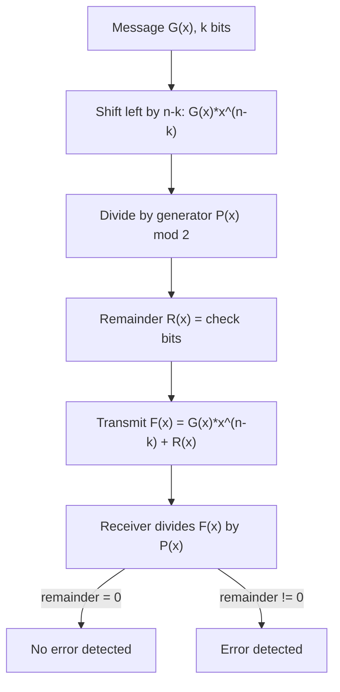

## Summary

CRC (Cyclic Redundancy Check) is a widely used error-detection method for
transmitted data, in which the message is treated as a polynomial over
GF(2) and divided by a fixed, standardized **generator polynomial**;
the remainder becomes the **check bits** appended to the message.

## Core method

For a message of `k` bits, represented as polynomial
`G₁(x) = Σ_{i=0}^{k-1} aᵢ·xⁱ`:

1. Append `n-k` zero bits to the message (shift left by `n-k`, i.e.
   multiply by `x^(n-k)`), where `n-k` is the degree of the generator
   polynomial `P(x)`.
2. Divide `G₁(x)·x^(n-k)` by the generator polynomial `P(x)` (mod-2
   polynomial division — i.e. repeated XOR, no borrow/carry):
   `G(x)·x^(n-k) = P(x)·Q(x) + R(x)`.
3. The check bits are the remainder `R(x)` (padded to `n-k` bits).
4. The transmitted frame `F(x) = G(x)·x^(n-k) + R(x)` is exactly
   divisible by `P(x)`.
5. The receiver divides the received frame by the same `P(x)`: a nonzero
   remainder means a transmission error was detected.

## Worked examples

- **CRC-5** (`P(x) = 100101`, degree `n-k = 5`): encoding
  `G = 1111110` by polynomial division, producing a frame
  `F = G·R` with the 5 check bits `R` appended.
- **CRC-7** (`P(x) = x⁷+x³+1 = 10001001`, degree `n-k = 7`): message
  `H = 1100111000110` encoded/decoded by the same division process;
  verifying a received frame against `CRC-7` by dividing again and
  checking for a zero remainder (`⇒ kein Fehler erkannt`, no error
  detected, in the worked check).

## Error-detection guarantees

- CRC detects **all odd numbers of bit errors**, provided the generator
  polynomial contains the factor `(1+x)`.
- **Theorem (from source)**: a generator polynomial `P(x)` of degree
  `n-k` detects **all burst errors of length `b ≤ n-k`**, where a burst
  error of length `b` is a contiguous run of possibly-flipped bits
  bounded by the first and last error bit.
- For burst errors **longer** than `n-k`, detection is no longer
  guaranteed for every possible error pattern, but a large fraction still
  is — e.g. the source computes for CRC-5 that burst errors of length
  `b=6` are still detected in 93.750% of cases, and `b>6` in 96.875% of
  cases (since not every error polynomial of that length happens to be a
  multiple of the generator polynomial).
- **Key limitation**: "Not every generator polynomial of the form `(1+x)`
  detects every possible burst error" — detection is probabilistic once
  the burst length exceeds the polynomial's degree, not guaranteed.

## Related pages

- [[topics/mips-pipeline-and-hazards]]
- [[topics/computer-architecture-and-isa]]

## Open questions / gaps

- The exact standardized CRC-5/CRC-7 generator polynomials used in
  industry (e.g. for USB, as referenced in one exercise) were given
  directly in the exercise rather than derived — noted here as given
  constants, not independently verified against an external standard.
