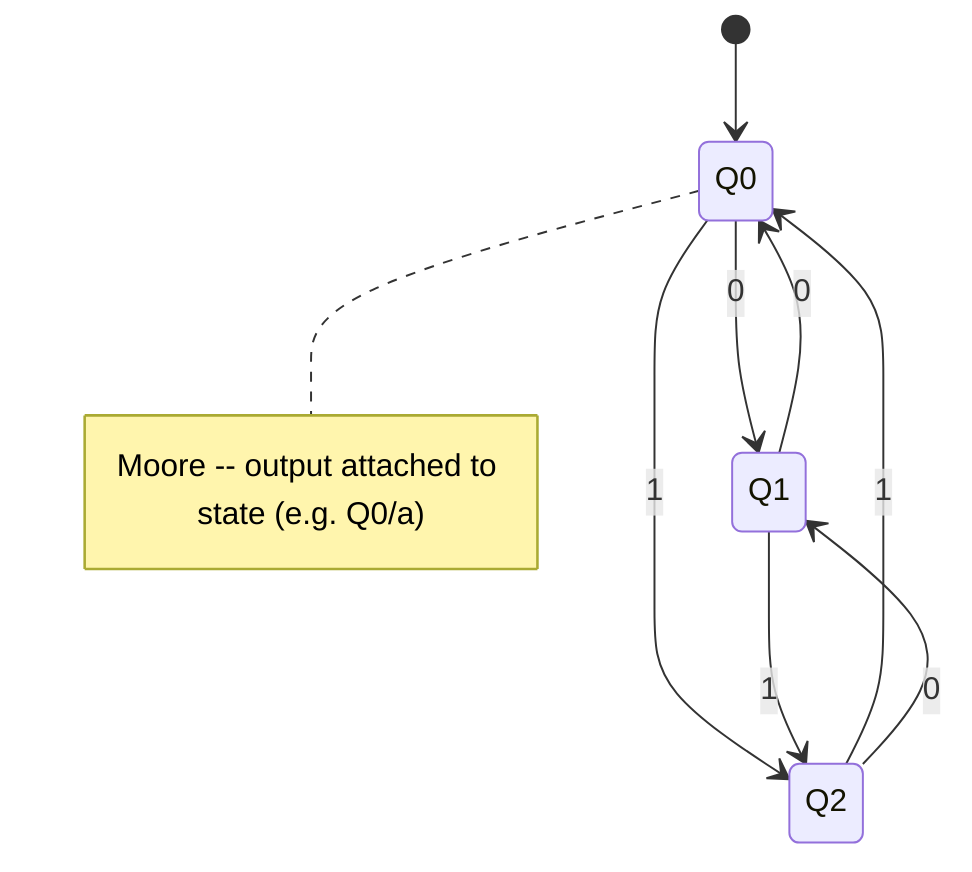
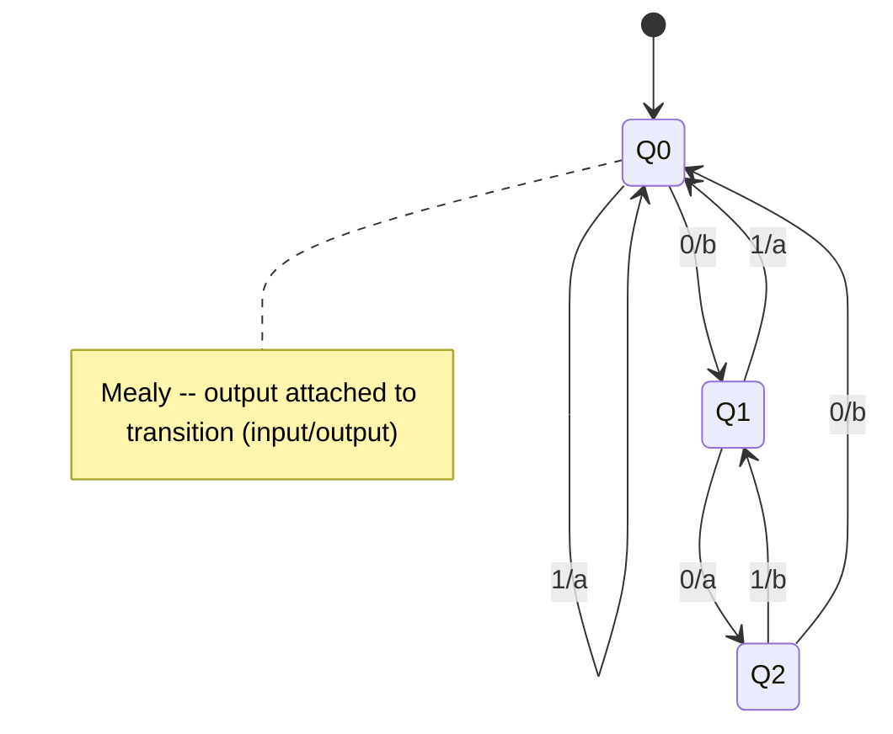
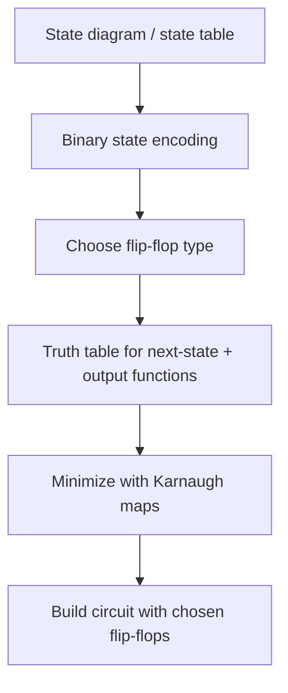

## Summary

Moore and Mealy automata are the two standard models of finite-state
machines (Automaten) used to design sequential circuits. Both are finite
automata (the number of states, inputs, and outputs is finite), typically
drawn as directed graphs: nodes = states, edges = state transitions.

## Moore vs. Mealy

- **Moore automaton**: output depends only on the **current state**. The
  output changes only once the automaton has reached a (new) state.
- **Mealy automaton**: output depends on the **current state and the
  current input**. The output can change immediately on an input change
  (within the same clock cycle).

## Converting between them

### Moore → Mealy
Move each state's output onto every incoming transition edge: the Mealy
transition arriving at state `Q` carries the output that Moore attaches to
`Q`.

### Mealy → Moore (more involved)
1. For every node: if it has no incoming edges with differing outputs,
   nothing to do.
2. If a node has multiple incoming edges with **different** outputs,
   duplicate the node once per distinct output value, and reroute incoming
   edges so each duplicate only receives edges of one output value.
3. For every edge: move its output label onto the (possibly duplicated)
   node it points to.

This can increase the number of states, since a single Mealy state may
split into several Moore states to represent each reachable output value.

## Design process (from source "overview" page)

**Moore automaton:**
1. State diagram or state table.
2. Binary state encoding, binary state table.
3. Choice of flip-flop type.
4. Truth table for the output function.
5. Minimize next-state and output functions.
6. Build the circuit.

**Mealy automaton:** same steps, but the state diagram/table and the
minimization must additionally account for the output depending on the
input, not just the state.

## Worked example: Mealy sequence detector

The source designs a Mealy automaton with binary input `E` and binary
output `Y` that outputs 1 once the input sequence `0,1,0,1` has been seen
(and continues outputting 1 on repeats), implemented with D flip-flops.
The design flow: state diagram with 5 states (Z0..Z4) → encoded state table
→ next-state K-maps for each flip-flop input → minimized DNF per flip-flop
→ final circuit.

## Worked example: vending-machine Moore automaton

A coin-operated vending machine exercise (Blatt 7): a "Taler" (token)
counter `Z` and output `U` (vend signal). Rules: a banana costs 2 tokens
(`Z=0 → S=0, U=1`), an apple costs 1 token (`Z=0 → S=1, U=1`), inserting a
token increases `Z` by 1 (`Z=1`); if too many tokens (`Z≥2`) are present,
`U=0`. Designed as a 5-state Moore automaton (`Z0..Z4`), with transitions
on token-insert (`1`) and vend (`0`) events, each state tagged with its
`(S, U)` output pair. The follow-up derives the binary state table
(`Q2 Q1 Q0` encoding), the next-state table, and the D flip-flop input
equations (`D2 D1 D0`) needed to implement it.

## Worked example: sensor-based alarm Mealy/Moore automaton

A burglar-alarm exercise (Blatt 7) with four sensors: a light/dark sensor
`H` (Hell/Dunkel), a noise sensor `L` ("genau 8 Takte" duration), a
360° rotation sensor `D` (Drehsensor), and a glass-break sensor `G`
(Glasbruchsensor). Rule: if `G=1`, go straight to the alarm state `F`
("Fehlzustand") from the start state `Z` ("Ausgangszustand"). Otherwise,
as long as `H=0` stay in the start state; once `H=1` the machine moves to
an intermediate state `A`, from which `H=1 ∧ L=1` triggers alarm state `B`;
from `B`, `H=0` returns to the start state while other input combinations
loop back through `A`/`D`/`G`. The design shows the state diagram (5
states incl. start `Z` and alarm `F`) and its fully-expanded binary
transition diagram over the 4 sensor inputs.

## Related pages

- [[topics/flip-flops-and-sequential-logic]]
- [[concepts/karnaugh-map]]
- [[topics/computer-architecture-and-isa]]
