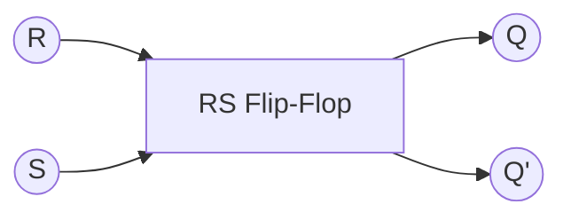
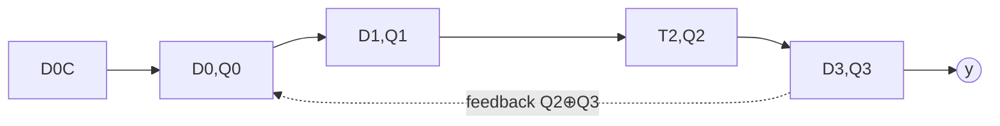

## Summary

Unlike combinational circuits, sequential circuits (Schaltwerke) have
feedback (Rückkopplung) and store state over time. Flip-flops are the
fundamental 1-bit memory element; registers and shift registers are built
by chaining them.

## Combinational vs. sequential circuits

- **Asynchronous circuit (Asynchrones Schaltwerk)**: changing inputs cause
  immediate, variable results ("Eilfall" — race condition risk).
- **Synchronous circuit (Synchrones Schaltwerk)**: state changes are gated
  by a clock signal ("Taktfall").
- A key distinguishing feature: a Schaltwerk (sequential circuit) can have
  feedback (Rückkopplung); a pure Schaltnetz (combinational circuit) cannot.

## RS flip-flop

| R | S | Q' | |
|---|---|----|---|
| 0 | 0 | Q (hold) | |
| 0 | 1 | 1 | → Set |
| 1 | 0 | 0 | → Reset |
| 1 | 1 | — | (forbidden/undefined) |

## Clocked / edge-triggered flip-flops

- **Level-triggered (Pegelgetriggert)**: value can change any time the
  clock = 1 (not just once per cycle) — considered unreliable for most
  designs.
- **Master-slave / edge-triggered (Flankengetriggert)**: output only
  changes on a rising or falling clock edge.
  - Positive edge (rising): triggers on 0→1 transition.
  - Negative edge (falling): triggers on 1→0 transition.

## D flip-flop

| D | C (clock) | Q' |
|---|-----------|----|
| 0 | 0 | Q (hold) |
| 0 | 1 | 0 |
| 1 | 1 | 1 |

An edge-triggered D flip-flop takes the D input and, on the triggering
clock edge, copies it to output `Q`; `Q` then holds that value until the
next triggering edge, regardless of further changes on `D`. Used to build
registers.

## JK flip-flop

| C | J | K | Q' | Behavior |
|---|---|---|----|----------|
| 1 | 0 | 0 | Q | Hold |
| 1 | 0 | 1 | 0 | Reset |
| 1 | 1 | 0 | 1 | Set |
| 1 | 1 | 1 | Q̄ | Toggle |

The JK flip-flop fixes the RS flip-flop's forbidden `1,1` state by making
it a defined **toggle**.

## T flip-flop

| C | T | Q' |
|---|---|----|
| 1 | 0 | Q (hold) |
| 1 | 1 | Q̄ (toggle) |

A T flip-flop (from "Toggle") flips its output every active clock edge when
`T=1` — the basis of binary counters.

## Shift registers (Schieberegister)

A chain of D flip-flops where each stage's output feeds the next stage's
input, shifting a bit pattern through the register once per clock cycle.
The source works through a 4-stage shift register with feedback
(`D₀ = Q₂⊕Q₃`, i.e. an XOR tap) — a **linear feedback shift register**
pattern — tracing the state sequence `Q₀Q₁Q₂Q₃` cycle by cycle.

## Related pages

- [[topics/finite-state-machines]]
- [[concepts/karnaugh-map]]
- [[topics/combinational-circuits-mux-demux]]
