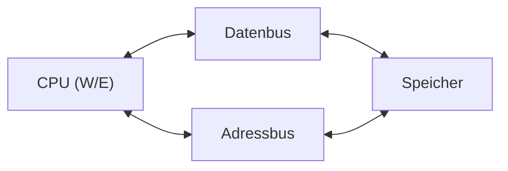
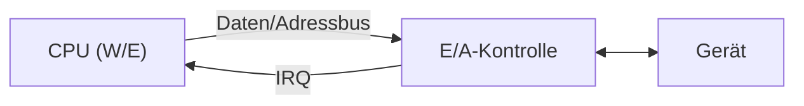
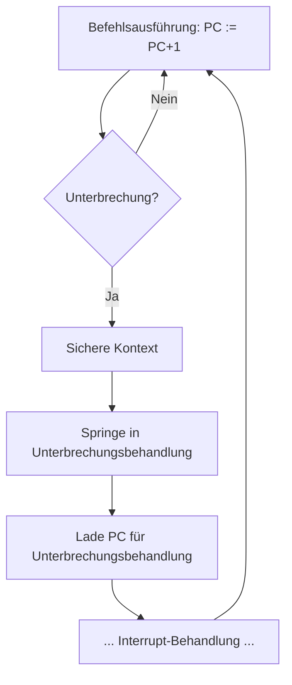

## Summary

How the CPU communicates with peripheral devices: memory-mapped vs.
separate I/O addressing, synchronous vs. asynchronous (handshake-based)
buses, polling vs. interrupt-driven I/O handling, DMA for bypassing the
CPU on bulk transfers, and bus topologies/arbitration for multi-device
buses.

## I/O address space: memory-mapped vs. separate

- **Memory-mapped I/O (gemeinsamer Speicher-/Geräte-Adressraum)**:
  devices and memory share one address space; the CPU accesses a device
  the same way it accesses memory (same `lw`/`sw`-style instructions).
  - *Advantage*: large I/O address range usable; few extra instructions
    needed in the processor design; no separate I/O instructions
    required.
  - *Disadvantage*: device I/O timing is coupled to the bus clock/timing
    ("Belastung I/O-Timing mit I/O-Bustakt"); device access speed competes
    directly with memory-access bandwidth.
- **Separate I/O address space**: devices sit behind their own dedicated
  I/O controller/bus (`CPU ↔ E/A ↔ Gerät`), addressed with distinct
  instructions from memory accesses — isolates I/O timing from memory
  timing at the cost of extra dedicated instructions/decoding logic.

## Interrupt-driven I/O

An **interrupt (Unterbrechung)**: "Rückkanal von Gerät über den I/O-Bus
zur CPU; Anforderung einer Behandlung (z.B. Ticks)" — a device signals
the CPU asynchronously via a dedicated request channel (`IRQ`) when it
needs servicing, instead of the CPU having to continuously ask.

## Synchronous vs. asynchronous buses

- **Synchronous bus**: communication partners rely on a shared, fixed
  timing (clock) known in advance ("Kommunikationspartner verlassen sich
  auf eine festgelegte Zeit zwischen wiederkehrenden Timing").
- **Asynchronous bus**: communication partners coordinate via a
  **handshake signal**, each side proceeding only once the other has
  confirmed readiness ("Kommunikationspartner koordinieren per
  Handshaksignal, dass sie in der erwarteten Weise reagiert haben").

## Unidirectional vs. bidirectional transfer

| | Unidirectional | Bidirectional |
|---|-----------------|----------------|
| Advantage | simple, fast when only one direction is needed | flexible, higher data throughput via shared I/O lines (fewer physical lines reused for both directions) |
| Disadvantage | needs a separate line/path in each direction | needs asynchronous bus timing/coordination (synchronous timing doesn't fit shared bidirectional lines as well) |

## Polling vs. interrupts

- **Status-polling loop**: the CPU repeatedly reads a device's "ready"
  bit in a tight loop (`wait → read status bit → ready? → no: loop
  again; yes: transfer data`) until the device signals readiness.
  Simple but wastes CPU cycles busy-waiting, and reaction latency depends
  on how often the CPU happens to poll.
- **Polling (general)**: "gelegentliches Prüfen des Bereit-Bits mit
  verschiedenen Bearbeitungsaufgaben" — the CPU periodically checks a
  device's status between other work, rather than busy-waiting
  continuously.
- **Interrupt-driven**: the device actively signals the CPU
  (`IRQ`/interrupt) when it needs attention; the CPU's main instruction
  loop normally just increments `PC := PC+1`, but on an interrupt it
  detours to save context, service the interrupt, restore context, then
  resume — avoiding wasted busy-wait cycles, at the cost of interrupt
  handling overhead and need for context save/restore.

## DMA (Direct Memory Access)

With DMA, bulk data transfer happens directly **between a device
controller and memory**, bypassing the CPU entirely: "Bei DMA wird die
Datenübertragung zwischen Gerätesteuerung und Speicher durchgeführt, ohne
CPU." This requires that the device controller can act as a **bus
master** ("DMA wird es erfordert, dass Gerätesteuerung Bus-Master werden
kann"), i.e. it must be able to drive the shared bus itself instead of
only responding to CPU-initiated transfers.

## Bus topologies

- **Daisy-chain technique (Daisy Chain Technik)**: devices are wired in a
  chain (`Arbitrierungslogik ↔ Gerät1 ↔ Gerät2 ↔ Gerät3 ↔ ... ↔ Bus`), and
  bus-grant/priority signals propagate sequentially down the chain from
  one device to the next.
- **Parallel/central arbitration**: each device connects independently to
  a shared arbitration register/logic block and the bus
  (`Bus ↔ Arbitrierungsregister ↔ Gerät1/2/3` in parallel), rather than
  chaining through other devices — avoids the daisy-chain's dependency on
  every upstream device passing the signal along correctly.

## Bus arbitration

**Bus arbitration (Busarbitrierung)**: the procedure that decides which
bus participant may exclusively drive ("access") the bus at a given time.
It must prevent two specific problems:
- **Electrical short circuits (elektrische Kurzschlüsse)** — two devices
  driving the bus simultaneously with conflicting signal levels.
- **Bus starvation (Bus-Verhungern)** — a device being perpetually denied
  bus access by higher-priority or more persistent competitors.

## Related pages

- [[topics/line-coding-and-signal-encoding]]
- [[topics/virtual-memory-and-caching]]
- [[topics/computer-architecture-and-isa]]

## Open questions / gaps

- The source doesn't name a specific arbitration algorithm (e.g.
  round-robin, fixed-priority) beyond stating the two problems it must
  avoid — flagged in case a concrete arbitration scheme is covered in a
  later source.
