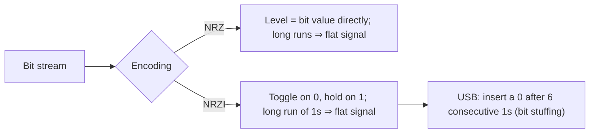

## Summary

Serial buses encode a bit stream as a physical voltage signal using a
**line code**. This page covers the two line codes compared in the
source — NRZ and NRZI — and how they're used by SATA and USB
respectively, plus the clock-synchronization problem they create.

## NRZ (Non-Return-to-Zero)

Each bit is directly represented by a signal level, with **no return to a
neutral/zero level between bits**: "jedes Bitwert ist an jeder
Signalperiode zugeordnet" — a `1` holds the signal high for the whole bit
period, a `0` holds it low, and consecutive identical bits produce a flat
(unchanging) signal level rather than returning to zero each period.
Used as the (de facto) physical signal basis checked against a SATA
signal trace in the source's worked exercise.

## NRZI (Non-Return-to-Zero Inverted)

The signal **toggles (inverts) on every `0` bit** and **stays the same on
every `1` bit** — "Signalpegel wechselt bei der Übertragung einer 0 und
bleibt bei der Übertragung einer 1." This is the encoding used by **USB**.

- **Synchronization problem**: NRZI (and NRZ) has no guaranteed signal
  transition when a long run of the same bit value is sent (e.g. many `1`s
  in a row under NRZI produce no transitions at all), which breaks clock
  recovery at the receiver — "es hat das Synchronisationsproblem, dass
  auftritt, wenn zu viele 1 oder 0 nacheinander gesendet werden."
- **Bit stuffing fix (noted for USB)**: after 6 consecutive `1` bits, a
  `0` is forcibly inserted into the stream purely to force a transition
  and keep the receiver's clock synchronized ("bei USB → 6× 1 → 0").

## Related pages

- [[topics/io-systems-and-buses]]
- [[topics/error-detection-crc]]

## Open questions / gaps

- The exact SATA line-coding scheme (8b/10b or similar) was not derived
  in the source beyond the NRZ signal-trace exercise; only the
  USB/NRZI side was explicitly named and explained with its bit-stuffing
  fix.
