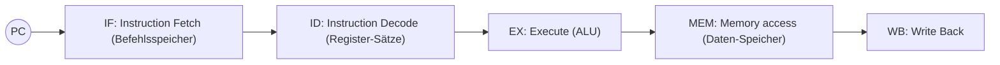
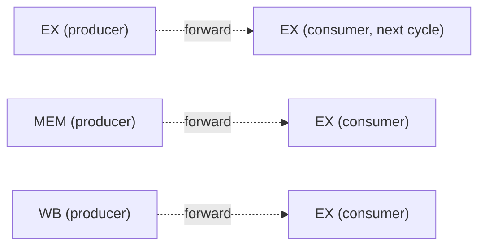

## Summary

A classic 5-stage MIPS instruction pipeline overlaps the execution of
consecutive instructions for throughput, but this creates **data
hazards** when one instruction depends on the result of another still
in flight. This page covers the pipeline stages, hazard types, and the
two standard fixes: stalling (NOP insertion) and forwarding/bypassing.

## The 5-stage pipeline

1. **IF**: fetch the current instruction from the instruction memory at
   `PC`, advance `PC`.
2. **ID**: the instruction decoder reads and decodes the current
   instruction, reads the needed register operands.
3. **EX**: the ALU computes the instruction's result.
4. **MEM**: memory access (for loads/stores).
5. **WB**: the result register is written back.

A pipeline diagram tracks each instruction's stage per clock cycle in a
table (rows = instructions, columns = clock cycles), with each
instruction entering `IF` one cycle after the previous one.

## Stalls vs. flushes

- **Stall (Anhalten)**: hold one or more pipeline stages for one or more
  cycles (by inserting NOPs/"bubbles") — used to resolve a **data
  hazard** when an operand isn't ready yet.
- **Pipeline flush**: discard instructions already loaded into the
  pipeline, converting them into NOPs, rather than letting them complete
  — used when the pipeline has fetched instructions out of the correct
  control-flow path (e.g. after a taken branch).

## Hazard types (data dependencies)

| Type | Meaning | Rule |
|------|---------|------|
| **RAW** (Read-After-Write) | a later instruction reads a register before an earlier one has written it | B2 may not read until B1 has written (reached WB) |
| **WAR** (Write-After-Read) | a later instruction writes a register before an earlier one has read it | — |
| **WAW** (Write-After-Write) | two instructions write the same register, and the writes must stay in program order | — |

As noted on the source: "RAW" occurs when an instruction is not yet
finished (hasn't reached WB) and a later one wants to read what it will
write; "WAW" occurs between every instruction and every instruction
written after it. Worked exercise: a 5×5 dependency matrix for
instructions `B1..B5` classifies every ordered pair as RAW / WAR / WAW / `∅`.

## Hazard detection, stalling, branches

- **Hazard detection**: implemented via inserted NOPs (Hazard-Detection ⇒
  "Einfügen von NOPs"). A hazard-detection unit compares the register
  operands needed in `ID` against the destination registers of
  in-flight instructions, inserting a NOP ("bubble") when a RAW hazard
  is detected (operand not available yet).
- **Branch resolution**: `bne`/branch instructions are resolved in the
  **ID** stage (general jump/branch rule): "bne wird in ID ausgeführt."
  Because the branch target/outcome is known early (in ID, not later),
  fewer cycles are wasted than if resolved in EX.
- A structural note from the source: a register written in `WB` cannot
  be safely read until that write has actually committed; code that
  reads a register immediately after a preceding `lw` to the same
  register needs a stall unless forwarding handles it.

## Forwarding / bypassing

**Forwarding (Bypass)**: a value computed in `EX` or available at the end
of `MEM`/`WB` is routed ("bypassed") directly to a later instruction's
`EX` stage, instead of waiting for it to be written back to the register
file and re-read. The source annotates this as "Bypass: MEM/WB-Phase in
die EX-Phase" — i.e. forwarding paths from the MEM and WB pipeline
registers back into the EX stage's ALU inputs.

- With forwarding, many RAW hazards that would otherwise need a stall
  can be resolved without any NOPs.
- Exception: a **load-use hazard** (an instruction immediately following
  a `lw` tries to use the loaded value) still needs **one** stall cycle,
  because the loaded value isn't available until the end of `MEM`, one
  cycle later than an ALU result would be.
- A branch instruction (`lw`/jump) resolved in **ID** is too early for the
  EX-stage bypass to help it directly — the source notes "bue (Jump-
  Befehl) wird in ID ausgeführt, deswegen hilft der Bypass zum EX-Code
  nicht ⇒ NOP wird eingefügt", i.e. branches still need a NOP/stall even
  with forwarding in place, since the hazard is detected before the
  bypass point.

## Related pages

- [[topics/computer-architecture-and-isa]]
- [[topics/binary-arithmetic-and-adders]]

## Open questions / gaps

- The worked pipeline-diagram exercises (Blatt 9, pages with the full
  IF/ID/EX/MEM/WB grids) trace specific instruction sequences cycle by
  cycle; the underlying instructions/registers were legible but are not
  fully reproduced here — refer to `raw/summaries/ti_3.pdf` pages 2-9 for
  the exact register numbers if a worked trace is needed later.
