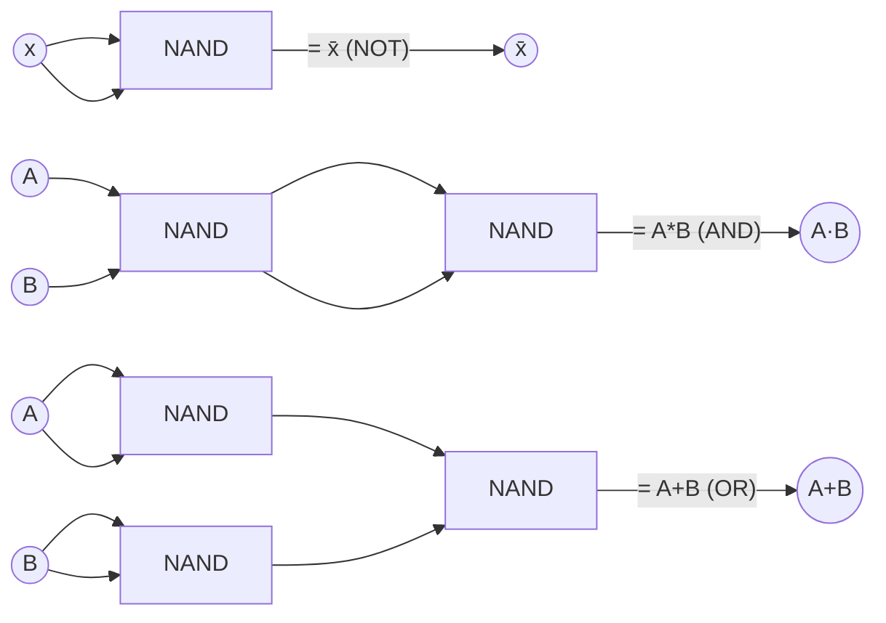

## Summary

A switching function (Schaltfunktion) `f(x,y)` maps binary inputs to a
binary output and is physically implemented as a logic gate. The source
builds up the standard gate set from truth tables and shows how a single
gate type (NAND or NOR) can implement all of Boolean logic — functional
completeness.

## Standard 2-input gates

| Gate | Truth table (x,y → f) | Formula |
|------|------------------------|---------|
| NAND (Sheffer) | 00→1, 01→1, 10→1, 11→0 | `f = x̄+ȳ` (≡ `(x*y)‾`) |
| NOR | 00→1, 01→0, 10→0, 11→0 | `f = x̄*ȳ` (≡ `(x+y)‾`) |
| XOR ("⊕") | 00→0, 01→1, 10→1, 11→0 | `f = x̄*y + x*ȳ` |
| XNOR / Equivalence | 00→1, 01→0, 10→0, 11→1 | `f = x*y + x̄*ȳ` |
| Negation (NOT) | 0→1, 1→0 | `f(x) = x̄` |
| Identity | passes input through | `f(x) = x` |
| Zero function (Nullfunktion) | always 0 | `f(x) = 0` |
| One function (Einsfunktion) | always 1 | `f(x) = 1` |

The source also names NAND = **Sheffer function**, and marks AND/OR
constructed purely from NAND gates as "Peirce" and "Sheffer"-style builds.

## Functional completeness (NAND-only / Sheffer circuits)

Because `x̄ = (x*x)‾`, `x*y = ((x*y)‾)‾`, and `x+y = (x̄*ȳ)‾` (De Morgan), any
Boolean function can be built from **NAND gates alone**:

- **NOT**: tie both NAND inputs to the same signal: `x NAND x = x̄`.
- **AND**: NAND followed by a NOT-via-NAND: `(x NAND y) NAND (x NAND y) = x*y`.
- **OR**: NAND the complements: `x̄ NAND ȳ = x+y` (De Morgan).

Worked exercise: minimizing the number of distinct NAND gates needed to
build a given hardware function. For
`g(T,U,N,E) = T*U + N*E` (De Morgan rewritten as
`(T̄+Ū)‾ * (N̄+Ē)‾`... simplified in the source to `(T̄*Ū)‾ * (N̄*Ē)‾`), the
source concludes the circuit needs **3 NAND gates**.

## Related pages

- [[topics/boolean-algebra]]
- [[concepts/karnaugh-map]]
- [[topics/combinational-circuits-mux-demux]]

## Open questions / gaps

- The handwritten NAND-gate-count derivation (page 8 of ti_1.pdf) has some
  crossed-out intermediate steps; the final answer (3 NAND gates) is clear
  but one intermediate simplification line was illegible.
