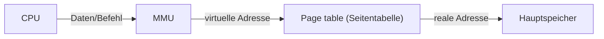
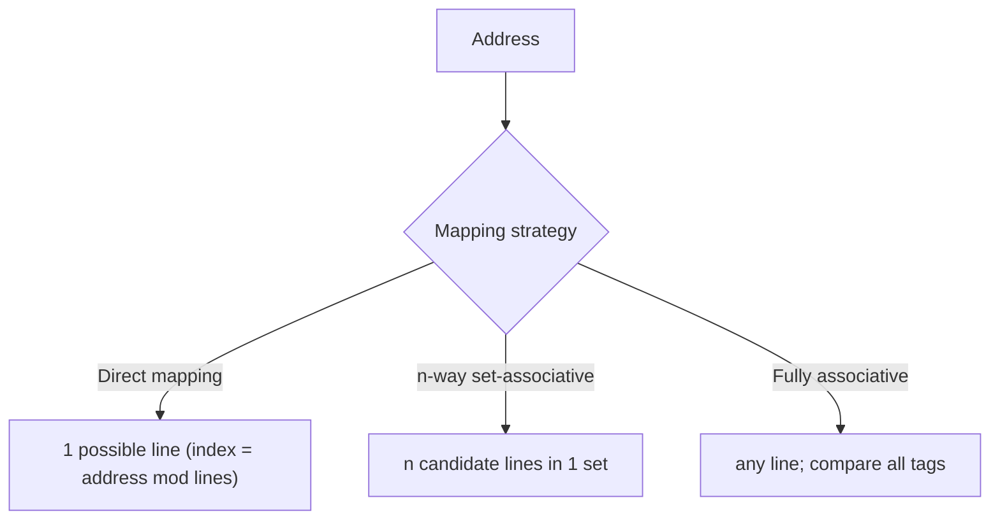
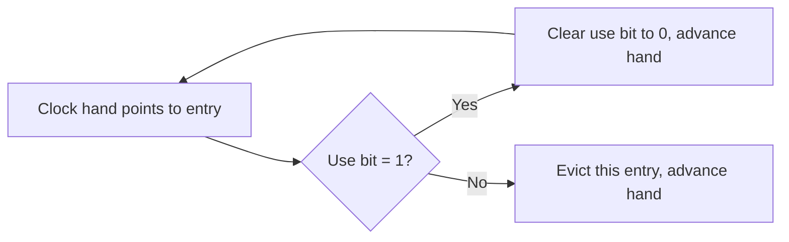

## Summary

Virtual memory lets processes share a limited physical main memory
larger than any single process could otherwise use, by indirecting every
memory access through a translation step (paging). Caches then speed up
access to both virtual-to-physical translations (via a TLB) and the
actual data, using one of several line-placement ("mapping") strategies.

## Virtual memory and paging

- **Motivation**: processes don't all need all their memory pages at
  once, and in aggregate may need more memory than physically available
  — "Prozesse benötigen nicht alle Speicherstellen gleich häufig" /
  "Prozesse benötigen eventuell mehr Speicher als Hauptspeicher
  vorhanden."
- **Pages (Pages/Seiten)**: the unit of the virtual address space is
  divided into fixed-size pages.
- **Page table**: maps each virtual address (page) to a real/physical
  address (frame); conceptually similar to a NAT (network address
  translation) table.



- **Page-table trade-off**: table size may not scale to cover the full
  virtual address space — a small table wastes less memory but can't map
  everything; a large table can map more but costs more memory.

## TLB (Translation Lookaside Buffer)

A small, fast hardware cache of recent virtual→physical translations
("Übersetzungs-Cache"), placed in the MMU's address-translation path to
avoid walking the full page table on every access, since "Zugriff zum
Hauptspeicher ist teuer" (main-memory access is expensive) and "häufig
dieselben Tabelleneinträge erhalten werden" (the same table entries are
frequently reused).

## Cache line-placement strategies

The same mapping problem (where can data/a translation live in a smaller,
faster structure?) applies to both the TLB and a data/instruction cache,
with three standard strategies:

1. **Direct mapping**: each virtual/memory address maps to exactly **one**
   fixed line/slot in the cache or TLB (via an index derived from the
   address). Simple and fast, but any two addresses that alias to the
   same line will repeatedly evict each other even if the rest of the
   cache is unused.
2. **n-way set-associative mapping**: each address maps to a fixed *set*
   of `n` candidate lines (not just one); a new entry can go into any of
   the `n ≥ 2` lines of its set, and all lines in the set are searched in
   parallel on lookup.
3. **Fully associative mapping**: any address can be placed in **any**
   line of the cache/TLB; every entry's tag must be compared against the
   requested address on every lookup. This is the "set-associative
   mapping with `n` = (full size)" limit case.



## Direct-mapped vs. fully associative: trade-off

- A **fully associative cache** is more expensive and complex (needs a
  comparator per line to check every line's tag in parallel) — "ein fully
  associative cache ist in diesem Fall teurer, weil hierbei die
  Vergleichslogik im Komparator deutlich komplexer ist als dies bei
  einem direct mapped cache der Fall wäre." Every tag must be compared
  against the requested address simultaneously, unlike a direct-mapped
  cache, which only ever compares one line's tag.

## Cache fundamentals and the locality principle

- **Goal**: keep the data in cache that will be needed next, under the
  assumption of **locality of reference**: "data recently used is likely
  to be used again soon" (temporal locality) and "data near recently used
  data is likely to be used soon" (spatial locality).
- Caching strategy should optimize for this locality assumption rather
  than for arbitrary/unpredictable access patterns.

## Worked exercise: cache address bit breakdown

For a **direct-mapped cache** of total size 4 KiB, with a cache line size
of 32 bit and a byte-addressed 32-bit address space:

```
4 KiB / 32 Byte = 128 cache lines  →  7 index bits
32-bit address  =  tag bits + 7 index bits + offset bits
```
(the offset selects a byte within the 32-bit/4-byte line, the index
selects one of the 128 lines, and the remaining high-order bits form the
tag used to detect a cache hit/miss for that line).

A separate worked exercise computes, for a 32 Byte vs. 64 Byte cache
with 4-byte lines, the number of address bits needed for a 1:2
demultiplexer (to pick a line) and the gate count for the corresponding
2:1 multiplexer tree that reads the selected line back out.

## Cache page-replacement algorithms

When a cache/TLB set is full, a worked exercise (Blatt 12) compares three
line-replacement policies on the same reference string, each tracking
which cache line (`B0..B3`) gets evicted:

- **FIFO (First-In, First-Out)**: evict the line that has been resident
  longest, regardless of recent use.
- **LRU (Least Recently Used)**: evict the line with the greatest "age
  since last use" — "Ersetze immer den Eintrag mit dem größten
  Nichtverwendungsgrad."
- **Clock (second-chance algorithm)**: entries are arranged in a circular
  buffer with a **use bit** per entry and a rotating "clock hand"
  pointer. On each access, the accessed entry's use bit is set to `1`
  ("durch die TLB/Cache-Hardware auf '1' gesetzt"). The clock hand never
  moves backward and only advances on the same cycle in which an entry
  is replaced. To replace: the hand examines the entry it points to —
  if its use bit is `1`, clear it to `0` and advance the hand (giving
  that entry a "second chance"); if its use bit is already `0`, evict
  that entry and advance the hand past it.



## Cache write policies

- **Write-through**: every write to the cache also immediately updates
  main memory ("unmittelbare Aktualisierung des Speichers").
  Simple/safe, but every write pays main-memory latency.
- **Copy-back (write-back)**: writes update only the cache line; the
  corresponding main-memory location is updated later, only when that
  cache line is evicted/replaced ("Rückschreiben erfolgt nur, wenn
  Cache-Zeile beim Miss verdrängt wird"). Faster for repeated writes to
  the same line, but requires a per-line "dirty" flag and more complex
  consistency handling.

## Virtual vs. real (physically-indexed) caches

- **Virtual cache**: sits *before* the MMU in the access path
  (`CPU → virtual-address cache → MMU → real address → memory`) — faster,
  since no address translation is needed before a cache hit can be
  checked.
- **Real (physical) cache**: sits *after* the MMU
  (`CPU → MMU → real-address cache → memory`) — slower per access (always
  needs translation first), but simpler consistency behavior.
- **Virtual cache, context switch problem**: the same virtual address can
  map to different real addresses under different processes ("Zu einer
  bestimmten Adresse im Cache gehört vor und nach einem Prozesswechsel
  eine andere Zelle im Speicher") — so a virtual cache must be fully
  **invalidated/flushed on every context/process switch**.
- **Virtual cache, synonym problem** (address aliasing): two different
  virtual addresses (from different processes, or the same process) can
  map to the **same** real memory location; a virtual cache can then hold
  two different copies of what is logically the same data, which is the
  **sharing** problem noted below.
- **Real cache**: not affected by the context-switch problem (no flush
  needed on process switch) or the synonym/aliasing problem (indexed by
  real address, which is unique).

## Cache coherence (multiprocessor sharing)

- **Bus snooping (Bus-Snooping)**: on a cache miss, all caches must check
  whether they hold a copy of the needed line and invalidate/update it as
  required, so every cache "overhears" (snoops) bus traffic for lines it
  holds.
- **Shared data (Sharing)**: when two processes/processors share data,
  both may cache separate copies of the same memory line; a real cache
  handles sharing by reloading the needed line from main memory on every
  process switch, keeping caches consistent at the cost of extra misses.

## Related pages

- [[topics/electronic-devices-and-memory]]
- [[topics/mips-pipeline-and-hazards]]
- [[topics/io-systems-and-buses]]

## Open questions / gaps

- The relationship between the `n:1`-multiplexer/`1:n`-demultiplexer
  gate-count exercise (page 25-26 of ti_3.pdf) and the direct/associative
  cache-mapping discussion later on the same sheet (Blatt 11/12) is not
  made fully explicit in the source — they may be two separate
  sub-exercises on the same topic rather than one continuous derivation;
  flagged in case the connection matters later.
